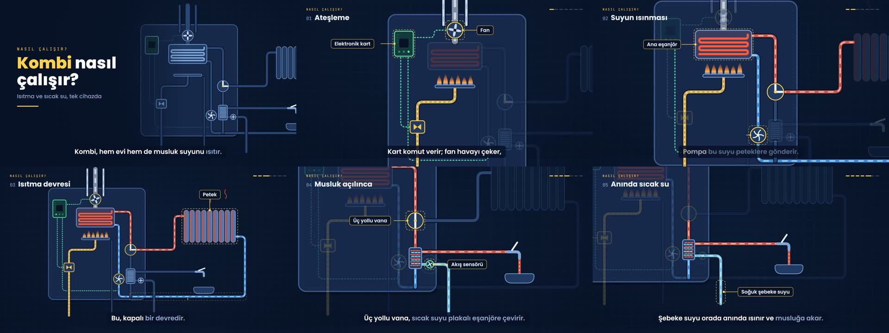
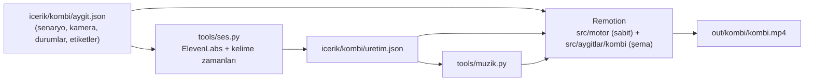

# AI Video Studio · *Nasıl Çalışır?*

**Bir aygıtın nasıl çalıştığını anlatan kısa açıklayıcı videoları kodla üreten stüdyo.**
Tasarım sabittir, içerik değişir. Yeni bir aygıt için gerekenler: bir şema dosyası ve bir içerik dosyası. Seslendirme (ElevenLabs), kelime zamanlı altyazı, müzik ve render tek komutla yapılır.



> İlk örnek: **Kombi nasıl çalışır?** (40 sn, 1920×1080) → [`ornekler/kombi.mp4`](ornekler/kombi.mp4)

---

## Özellikler

- **Sabit görsel dil.** Koyu teknik çizim zemini üzerinde düz kesit şemalar. Akış renklerinin anlamı sabittir (sıcak su, dönüş, şebeke suyu, gaz, baca gazı, elektrik…). Renk körlüğü için akışlar ayrıca desenle ayrılır.
- **Animasyonun tamamı kodla.** Borularda akan su, dönen pompa ve fan, titreyen alev, dönen vana. Odaktaki parça dışında her şey soluklaşır, sanal kamera parçaya yaklaşır. Hepsi kareye bağlı ve deterministiktir.
- **Veriyle sahne.** Her sahne bir seslendirme cümlesi, açık durumlar (ör. `"isitma"`, `"kullanim"`), odak parçaları, kamera ve etiketlerden oluşur.
- **ElevenLabs seslendirmesi ve kelime zamanları.** Sahne süresi sesin uzunluğundan gelir. Etiketler sözcüğü söylendiği anda belirir (`"soz": "pompa"`), altyazıda söylenen kelime vurgulanır.
- **Türkçe okunuş katmanı.** Metin resmi yazımla durur (altyazı bunu gösterir). Ses motoruna kısaltma, sayı ve adreslerin okunuşu gider.
- **Artımlı üretim.** Yalnızca metni, okunuşu ya da ses ayarı değişen sahneler yeniden seslendirilir.
- **Telifsiz müzik.** Video süresine göre bestelenir, konuşma sırasında otomatik kısılır.
- **Yaşayan belgeler.** Her geri bildirim [düzeltmeler günlüğüne](docs/DUZELTMELER.md) yazılır. Tekrar eden düzeltme kurala dönüşür.

## Kurulum

Gereksinimler: **Node.js 20+**, **Python 3.10+**, **ffmpeg / ffprobe** (PATH'te) ve seslendirme için bir **ElevenLabs API anahtarı**.

```bash
git clone https://github.com/HilmiTuncay/ai-video-studio.git
cd ai-video-studio
npm install
pip install -r requirements.txt
```

ElevenLabs anahtarını ortam değişkeni olarak tanımlayın (repoya yazılmaz):

```powershell
# Windows (kalıcı, kullanıcı düzeyi)
setx ELEVENLABS_API_KEY "sk_..."
```
```bash
# macOS / Linux
export ELEVENLABS_API_KEY="sk_..."
```

> Kombi örneğinin seslendirmesi ve müziği repoda hazırdır. Anahtar olmadan da `render` alınabilir.

## Hızlı başlangıç

```bash
node tools/uret.mjs kombi render      # repodaki seslerle videoyu üret → out/kombi/kombi.mp4
npm run studio                        # Remotion Studio'da kare kare önizleme
node tools/uret.mjs kombi kareler     # still görüntüler + kontak sayfası → out/kombi/kontak.jpg
node tools/uret.mjs kombi             # hepsi: ses → müzik → render
```

| Komut | Ne yapar |
|---|---|
| `node tools/uret.mjs <aygit> ses [--force]` | Değişen sahneleri ElevenLabs ile seslendirir |
| `node tools/uret.mjs <aygit> kontrol` | Whisper ile telaffuz kontrolü (isteğe bağlı `faster-whisper`) |
| `node tools/uret.mjs <aygit> muzik` | Süreye göre müzik besteler |
| `node tools/uret.mjs <aygit> render [--taslak]` | MP4 üretir (taslak: yarım çözünürlük) |
| `python tools/ses.py sesler` | Hesaptaki ElevenLabs seslerini listeler |
| `npm run tsc` | Tip denetimi |

## Nasıl çalışır?



Bir videonun **değişen** kısmı iki dosyadır:

| Dosya | İçerik |
|---|---|
| `icerik/<aygit>/aygit.json` | Başlık, ses seçimi, sahneler: seslendirme metni, kamera, `durum`, `vurgu`, `etiketler` |
| `src/aygitlar/<aygit>/Sema.tsx` | Aygıtın kesit şeması: parça kütüphanesiyle kurulur, parça kutuları (`PARCALAR`) kamera ve etiket çapasıdır |

**Sabit** kısım, yani motor, her videoda aynıdır:

```
src/motor/
  tema.ts        renkler, akış renkleri, yazı tipleri
  model.ts       veri modeli, zaman çizelgesi (sahne süresi = ses + nefes)
  baglam.tsx     şema bağlamı: durum değerleri, birikim, odak
  parcalar.tsx   parça kütüphanesi: Boru, Pompa, Fan, Alev, Esanjor, Plaka, Vana3, Kart, Sensor, Petek, Musluk…
  katman.tsx     kamera, etiketler, üst bant, kapak, kapanış, altyazı
  Aciklayici.tsx ana kompozisyon (müzik ducking, seslendirme, geçiş sesi)
tools/
  uret.mjs       üretim hattı
  ses.py         ElevenLabs seslendirme + kelime zamanları + Whisper kontrolü
  okunus.py/json Türkçe okunuş katmanı ve genel sözlük
  muzik.py       telifsiz müzik ve efekt sentezi
  kareler.mjs    still ve kontak sayfası
```

Örnek bir sahne:

```json
{
  "id": "isinma",
  "baslik": "Suyun ısınması",
  "ses": "Alev, ana eşanjördeki suyu ısıtır. Pompa bu suyu peteklere gönderir.",
  "kamera": { "x": 780, "y": 520, "z": 1.4 },
  "durum": ["kart", "fan", "gaz", "alev", "isitma"],
  "vurgu": ["hx", "brulor", "pompa", "vana"],
  "etiketler": [
    { "parca": "hx", "metin": "Ana eşanjör", "yon": "sol", "soz": "eşanjördeki" },
    { "parca": "pompa", "metin": "Pompa", "yon": "sol", "soz": "pompa" }
  ]
}
```

## Belgeler

| Belge | Konu |
|---|---|
| [docs/TASARIM.md](docs/TASARIM.md) | Sabit tasarım: biçim, renk anlamları, yazı, etiket ve altyazı kuralları |
| [docs/ANIMASYON.md](docs/ANIMASYON.md) | Seçilen animasyon yöntemi ve gerekçesi, değişmez kurallar, parça kütüphanesi |
| [docs/SES.md](docs/SES.md) | ElevenLabs ayarları, süre bütçesi, kelime zamanları, okunuş |
| [docs/ICERIK.md](docs/ICERIK.md) | `aygit.json` şeması ve senaryo yazım kuralları |
| [docs/YENI-AYGIT.md](docs/YENI-AYGIT.md) | Yeni aygıt ekleme kontrol listesi |
| [docs/URETIM.md](docs/URETIM.md) | Üretim hattı, çıktılar, doğrulama listesi |
| [docs/DUZELTMELER.md](docs/DUZELTMELER.md) | Düzeltmeler günlüğü ve kalıcı kurallar (yaşayan belge) |
| [docs/aygitlar/kombi.md](docs/aygitlar/kombi.md) | Kombi teknik notu: parçalar, çalışma, kaçınılacak yanlışlar |

Claude Code ile çalışırken ajan talimatları [CLAUDE.md](CLAUDE.md) dosyasındadır.

## Yol haritası

- [ ] 9:16 dikey yerleşim (Reels/Shorts): kamera ve etiket yerleşimi formatına göre
- [ ] Yeni aygıtlar: buzdolabı, klima, çamaşır makinesi…
- [ ] Parça kütüphanesine kompresör, tambur, motor ve kayış eklenmesi
