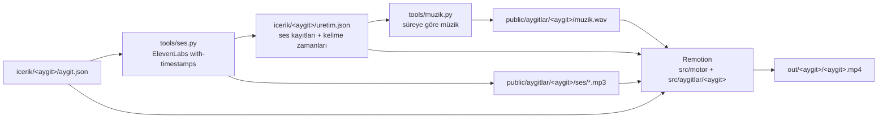

# Üretim hattı

## Komutlar

| Komut | Ne yapar |
|---|---|
| `node tools/uret.mjs <aygit>` | Hepsi: ses → müzik → render |
| `node tools/uret.mjs <aygit> ses [--force]` | Yalnız değişen sahneleri seslendirir |
| `node tools/uret.mjs <aygit> kontrol` | Whisper telaffuz kontrolü |
| `node tools/uret.mjs <aygit> muzik [--force]` | Video süresi değiştiyse müziği yeniden besteler |
| `node tools/uret.mjs <aygit> render [--taslak]` | `out/<aygit>/<aygit>.mp4` (taslak: yarım çözünürlük) |
| `node tools/uret.mjs <aygit> kareler [k,k,…]` | Still görüntüler ve kontak sayfası (`out/<aygit>/kontak.jpg`) |
| `npm run studio` | Remotion Studio: kare kare önizleme |
| `npm run tsc` | Tip denetimi |

Python yorumlayıcısı varsayılan olarak `python`'dur. Başka bir yorumlayıcı için `PYTHON` ortam değişkeni verilir.

## Akışın sırası

1. İçeriği düzenle (`aygit.json`).
2. `kareler` ile kontak sayfasına bak. Ses yokken süreler heceden tahmin edilir.
3. `ses` ile yalnızca değişen sahneleri üret.
4. `kareler` ile etiket senkronunu ve gerçek süreleri denetle.
5. `muzik`, ardından `render`.
6. İzle. Geri bildirimi [DUZELTMELER.md](DUZELTMELER.md)'ye işle; kural niteliğindeyse ilgili belgeye taşı.

## Çıktılar

| Yol | İçerik | Repoda |
|---|---|---|
| `icerik/<aygit>/uretim.json` | Ses kayıtları, kelime zamanları, müzik | ✔ |
| `public/aygitlar/<aygit>/ses/*.mp3` | Sahne seslendirmeleri | ✔ (anahtarı olmayan da render alabilsin diye) |
| `public/aygitlar/<aygit>/muzik.wav` | Müzik | ✔ |
| `out/` | Render ve still çıktıları | ✗ |
| `ornekler/*.mp4` | Yayınlanan örnek videolar | ✔ |

## Doğrulama listesi

- [ ] `npm run tsc` temiz geçiyor.
- [ ] Süre hedefe yakın (render çıktısındaki satır).
- [ ] Kontak sayfasında taşma yok.
- [ ] Ses: Whisper kontrolünde ciddi bir fark yok.
- [ ] Teknik doğruluk: aygıt notundaki "kaçınılacak yanlışlar" listesine aykırı bir ifade yok.
